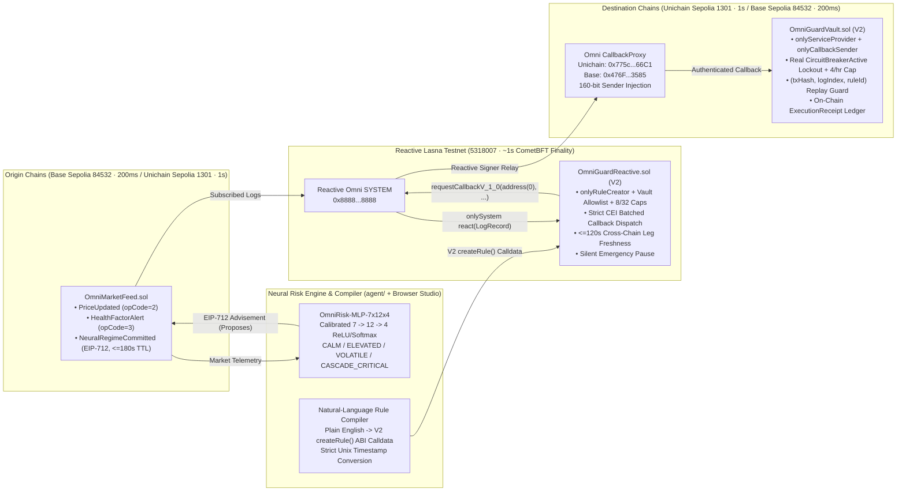

# OmniGuard AI (V2)

**Autonomous Cross-Chain DeFi Risk Sentinel & Security-Hardened Guardrail Engine on Reactive Omni (~1s CometBFT Finality)**

Built for the **DoraHacks Reactive Omni Buildathon** (Track: **Every Second Counts** · BUIDL [#51789](https://dorahacks.io/build/51789)).

| Judge Resource | Direct Link |
|---|---|
| **Public 1-Click Live RPC Workbench & Adversarial Breaker Lab** | **[https://alphonshhhomenicmtu.github.io/omniguard-ai/](https://alphonshhhomenicmtu.github.io/omniguard-ai/)** |
| **Live `/diag` 3-Chain RPC & Self-Test Panel** | **[https://alphonshhhomenicmtu.github.io/omniguard-ai/?tab=diag](https://alphonshhhomenicmtu.github.io/omniguard-ai/?tab=diag)** |
| **1080p Demo Video (2m 11s)** | **[https://youtu.be/pggBrUXMLTo](https://youtu.be/pggBrUXMLTo)** |
| **10-Slide Technical Pitch Deck (PDF)** | **[docs/omniguard-deck.pdf](docs/omniguard-deck.pdf)** |

---

## Live Verified On-Chain Executions (`Base Sepolia 84532 -> Reactive Lasna 5318007 -> Unichain Sepolia 1301`)

Two full end-to-end Reactive Omni loops are confirmed on-chain and live-readable directly from public RPCs inside the **Judge Receipt Verifier** tab (see [`deployments/testnet.json`](deployments/testnet.json) and [`deployments/last-proof.json`](deployments/last-proof.json)):

| Confirmed Loop | Origin Tx (`Base Sepolia 84532`) | Reactive `react()` Tx (`Lasna 5318007`) | Destination Callback Tx (`Unichain Sepolia 1301`) | Block-Timestamp Delta | Decoded Vault Outcome |
|---|---|---|---|---:|---|
| **Loop #1: Stop-Loss Hedge (Rule #1, `-6.00%` crash, `50%` hedge)** | [`0x1155b750...3243dd2`](https://sepolia.basescan.org/tx/0x1155b750cbe38ef1ede5727ef1819f7b8fd50625366c836a887e555a83243dd2) (blk `62980986`) | [`0x34598c2f...5d2e9f`](https://lasna.reactscan.net/tx/0x34598c2fb358b08bfb9ea5e6213f9377c33226db193fd29f4f0a0559355d2e9f) (blk `9131928`) | [`0xcb2cb194...8b1f4c`](https://sepolia.uniscan.xyz/tx/0xcb2cb194a1c4a561e911e253832021d8a9c3e8b6be3de9a87090f7e7fb8b1f4c) (blk `68665640`, Receipt `#0`) | **2 seconds** | `$100k -> $50k` WETH, `$25k -> $75k` USDC, `$60k` debt |
| **Loop #2: Closed-Loop EIP-712 Neural Circuit Breaker (Rule #3, `91.2%` risk, `65%` shift)** | [`0xb11c83b3...8b7f37`](https://sepolia.basescan.org/tx/0xb11c83b3b5893ab11209c8f2fb0efd62c3f25bc3d7e2585737cd360e288b7f37) (EIP-712 `ecrecover`) | [`0xdb6d3164...21c428`](https://lasna.reactscan.net/tx/0xdb6d3164304d8e7c24e92803bd36e0e0c3b70e3e0b443c1e4113adc97f21c428) (blk `9131931`) | [`0x60a45077...7783c2`](https://sepolia.uniscan.xyz/tx/0x60a450775431b9f27b2065b138cc6cfd737642ad31b16b3f92efd1e9ba7783c2) (blk `68665643`, Receipt `#1`) | **3 seconds** | `$50k -> $17.5k` WETH, `$75k -> $107.5k` USDC, `$60k` debt (`~1.94x` HF) |

> **Honest Latency Reporting:** On-chain block-timestamp deltas (`callbackTimestamp - originTimestamp`) are **2s** (Loop #1) and **3s** (Loop #2). Total end-to-end script wall-clock time recorded in `deployments/last-proof.json` (including Base Sepolia RPC broadcast confirmation, Reactive Lasna relay, and 1,000ms destination log polling) is **7,155 ms**. Both figures are displayed side-by-side in the live Judge Workbench.

### Deployed Contracts (Deployer: `0x06ECf94D9baAFB70daE7A499135e35D1156d4c03`)

| Network | Chain ID | Contract | Deployed Address | Deployment Tx |
|---|---:|---|---|---|
| **Base Sepolia** | `84532` | `OmniMarketFeed` (Primary Origin) | [`0xd30a3c3ddc662812b5bd37ca2cbc7b722a2a0f80`](https://sepolia.basescan.org/address/0xd30a3c3ddc662812b5bd37ca2cbc7b722a2a0f80) | [`0x2a2f09da...38b7df9`](https://sepolia.basescan.org/tx/0x2a2f09da274a30772c8e182a6146cdba8fc2226fc9e591c295cffacde38b7df9) |
| **Unichain Sepolia** | `1301` | `OmniMarketFeed` (Secondary Origin) | [`0xd30a3c3ddc662812b5bd37ca2cbc7b722a2a0f80`](https://sepolia.uniscan.xyz/address/0xd30a3c3ddc662812b5bd37ca2cbc7b722a2a0f80) | [`0x7c8d8e65...23b18345`](https://sepolia.uniscan.xyz/tx/0x7c8d8e65d6d5526bd6ba6a5f222fb31ebd3d06c77ec3105a7be5b0a123b18345) |
| **Reactive Lasna** | `5318007` | `OmniGuardReactive` (`AbstractReactive`) | [`0xb04fa6fa2eda6f378c0eefdd78eb625d2b4f5ef6`](https://lasna.reactscan.net/address/0xb04fa6fa2eda6f378c0eefdd78eb625d2b4f5ef6) | [`0x7eeeaeef...24c471d`](https://lasna.reactscan.net/tx/0x7eeeaeefaa31ce90ea9988419babd8456d2ff488d00be36303ba1f20024c471d) |
| **Base Sepolia** | `84532` | `OmniGuardVault` (`AbstractCallback`) | [`0x5b1066a69297e2ec1d1e46374184669568d3380c`](https://sepolia.basescan.org/address/0x5b1066a69297e2ec1d1e46374184669568d3380c) | [`0x1d8e2c25...d4439e`](https://sepolia.basescan.org/tx/0x1d8e2c2514fe57b6fa7e6058cef87338c1f2736b3638bcb8d329e31082d4439e) |
| **Unichain Sepolia** | `1301` | `OmniGuardVault` (`AbstractCallback`) | [`0x5b1066a69297e2ec1d1e46374184669568d3380c`](https://sepolia.uniscan.xyz/address/0x5b1066a69297e2ec1d1e46374184669568d3380c) | [`0xec51c6a6...3250f84`](https://sepolia.uniscan.xyz/tx/0xec51c6a6f610b00a323132dd5d6ca2804059ec67a148df345229f48853250f84) |

### Deployment Provenance (Testnet V1 Live Demo vs V2 Hardened Source)

The addresses in the table above are the 24 Nov 2026 testnet demo. A public bytecode read on 28 Nov 2026 (no new broadcast) shows those contracts still run that initial V1 demo runtime. `HEAD` in `contracts/src/` is the later V2 hardening. Forge proves the V2 source. It does not prove the bytecode at those addresses.

| What a judge is looking at | What it actually is |
|---|---|
| Lasna `OmniGuardReactive` `0xb04fa6fa2eda6f378c0eefdd78eb625d2b4f5ef6` (11,378 bytes) | V1 demo. `nextRuleId()` is `4`. `rules(1)` is the stop-loss whose callback wrote Unichain receipt `#0`. The dispatcher contains `createRule` and `NotRuleOwner`. It does not contain `onlyRuleCreator`, `authorizedRuleCreators`, `allowedDestinationVaults`, `pause`, or `trustedNeuralSigner`. |
| Unichain and Base `OmniGuardVault` `0x5b1066a69297e2ec1d1e46374184669568d3380c` (same 5,059-byte runtime on both chains) | V1 demo. `getReceipt(0)` matches Loop #1 above (2 second delta, `$100,000 -> $50,000` volatile). `getPosition` for `WETH/USDC` is the six-field V1 ledger: `$17,500` volatile, `$107,500` stable, `$60,000` debt, `circuitBreakerActive = true`. Replay storage is `executedOriginTx[originTxHash][ruleId]` (`DuplicateCallbackExecution(uint256,uint256)`). The runtime does not contain `CircuitBreakerActive`, `paused`, `maxSingleActionBps`, or `DuplicateCallbackExecution(uint256,uint256,uint256)`. |
| `contracts/src/` on this commit | V2 source, checked offline by `forge test`. `createRule` is `onlyRuleCreator` (owner or `authorizedRuleCreators`) and requires `allowedDestinationVaults`. Owner `pause()` / `unpause()` silence `react()` and revert vault callbacks with `VaultPaused()`. `maxSingleActionBps` caps each callback. Vault replay is `keccak256(originTxHash, logIndex, ruleId)`. After `CIRCUIT_BREAKER_PAUSE`, later `executeProtection` and `executeCrossChainRebalance` revert `CircuitBreakerActive(marketId)`. |

Receipt `#0` and receipt `#1` are real V1 demo transactions. The V2 controls in the next section live in source and in the Forge suite. They are not deployed at `0xb04fa6…` or `0x5b1066…`.

---

## V2 Security Hardening & Web3-Audit Verification

Following an internal adversarial red-team review of the V1 demo, the Solidity contracts in `contracts/src/` and the signer in `agent/` were hardened in source. The checks below are offline proofs of that source. The live addresses above are still the V1 demo bytecode described in **Deployment Provenance**.

| Security Check / Tool | Result | What It Proves |
|---|---|---|
| **Foundry Unit, Regression & Fuzz (`forge test`)** | **31 / 31 PASS** | Closes every P0/High/Med red-team finding + 256-run portfolio value conservation fuzz |
| **Foundry Stateful Invariants (`OmniGuardInvariants.t.sol`)** | **6 / 6 PASS** | **256 runs &times; 128,000 multi-actor calls (0 reverts, 0 violations)** across owner, attacker, pause, breaker & 200ms block rolls |
| **Aderyn (`v0.6.8`)** | **0 High** (`5` Low) | Strict CEI callback dispatch & owner-gated `coverDebt()` |
| **Slither (`v0.11.6`)** | **0 High · 0 Medium** (`7` Low, `3` Info) | Zero `reentrancy-eth`, zero `reentrancy-no-eth`, zero `divide-before-multiply`, zero `incorrect-equality` |
| **Gitleaks** | **0 Leaks** | Clean git history; `.env.testnet` ignored; fail-closed EIP-712 signer |
| **Dashboard Vitest + Agent Tests** | **32 / 32 + 5 / 5 PASS** | Breaker Lab guard parity, MLP monotonicity & NaN/upside guardrails, V2 ABI round-trip, live receipt decoder |

### Key V2 Contract Fixes (`contracts/src/`)
1. **Access Control & Allowlisting (`OmniGuardReactive.sol`)**: Gated `createRule()` with `onlyRuleCreator` (owner or allowlisted operators), added `allowedDestinationVaults[chainId][vault]`, capped active rules at **8 per market / 8 per vault / 32 total**, and added swap-and-pop pruning in `setRuleActive(false)` so `react()` never hits Lasna's ~900,000 gas ceiling.
2. **Emergency Pause & Real Circuit Breaker Lockout (`OmniGuardReactive.sol`, `OmniGuardVault.sol`)**: Added owner `pause()` / `unpause()` (`react()` returns silently when paused with zero wasted `ReactiveContractReverted` gas; vault callbacks revert `VaultPaused()`). Once `CIRCUIT_BREAKER_PAUSE` trips `circuitBreakerActive`, all subsequent `executeProtection()` and `executeCrossChainRebalance()` calls revert `CircuitBreakerActive(marketId)` until `clearCircuitBreaker()` is called. Added rolling 1-hour `maxActionsPerWindow` (default `4`) and `maxSingleActionBps` caps.
3. **Rule/Action Binding, Spread Freshness & Gas Floor**: Enforced strict `RuleKind <-> ActionType` pairing, rejected `ActionType.CROSS_CHAIN_REBALANCE` inside `executeProtection()` (eliminating silent no-op receipts), enforced `MAX_SPREAD_LEG_AGE_SECONDS = 120` on cross-chain price spread checks, raised `MIN_CALLBACK_GAS_LIMIT` to `450_000`, and keyed vault replay protection on `keccak256(originTxHash, logIndex, ruleId)`.
4. **Neural Advisement Bounds & Fail-Closed Signer (`OmniMarketFeed.sol`, `agent/src/eip712Signer.ts`)**: Bounded `validUntil <= block.timestamp + 180`, enforced `issuedAt` skew `<= 120s`, added two-step `transferOwnership`/`acceptOwnership`, invalidated old snapshots upon signer rotation, and removed the silent Anvil private key fallback in `eip712Signer.ts`.
5. **Strict Telemetry Honesty (`dashboard/`, `agent/src/server.ts`)**: Local simulations and the **Adversarial Breaker Lab** are explicitly badged **`SIMULATED`** and never stamp locally hashed simulator traces as `live-testnet`.

---

## Architecture



---

## Verified Reactive Omni Testnet Parameters

| Network | Chain ID | Public RPC | Official Omni System / CallbackProxy | Proxy Fee Params (`coeff / extraGas / maxChargeGas`) |
|---|---:|---|---|---|
| **Reactive Lasna** | `5318007` | `https://lasna-rpc.rnk.dev/` | `0x8888888888888888888888888888888888888888` | `1000` / `100,000` / `50,000` |
| **Base Sepolia** | `84532` | `https://sepolia.base.org` | `0x476F44b11F5C942c58f4c8E3d0300E5710743585` | `1100` / `80,000` / `50,000` |
| **Unichain Sepolia** | `1301` | `https://sepolia.unichain.org` | `0x775c9B990ADe401060B78D0e98684eEf8d2466C1` | `1100` / `80,000` / `50,000` |
| **Base Sepolia lREACT Faucet** | `84532` | `https://sepolia.base.org` | `0x2afaFD298b23b62760711756088F75B7409f5967` | `1 SepETH -> 100 lREACT` (max `5 ETH`) |

---

## Quick Start & Reproducible Verification

### 1. Live Zero-Setup Judge Workbench
Open **[https://alphonshhhomenicmtu.github.io/omniguard-ai/](https://alphonshhhomenicmtu.github.io/omniguard-ai/)** to inspect live `getReceipt(0)` & `getReceipt(1)` reads directly from Unichain Sepolia RPC, run all 6 attacks in the **Adversarial Breaker Lab**, test the **Neural & Rule Studio**, or open **[`?tab=diag`](https://alphonshhhomenicmtu.github.io/omniguard-ai/?tab=diag)** for the automated 3-chain self-test. GitHub Pages has no SPA fallback, so a bare `/diag/` path 404s until `dashboard/public/diag/index.html` is in the published build. The same static probe lives at [`docs/diag/index.html`](docs/diag/index.html).

### 2. Reproduce Smart Contract Unit, Fuzz & Stateful Invariant Suite
```bash
cd contracts
forge test -vv
```

### 3. Run Static Analysis & Secret Scan
```bash
cd contracts
aderyn .
slither . --exclude-dependencies
cd .. && gitleaks detect --source . --no-banner
```

### 4. Run Agent & Dashboard Vitest Suites
```bash
cd agent && npm test
cd ../dashboard && npm test && npm run build
```

---

## Repository Structure

```text
reactive-omni/
├── contracts/
│   ├── src/
│   │   ├── interfaces/IOmniGuardTypes.sol       # V2 enums, structs, caps, canonical topic0 constants
│   │   ├── origin/OmniMarketFeed.sol            # Price/HF feed + bounded EIP-712 neural verifier
│   │   ├── reactive/OmniGuardReactive.sol       # V2 allowlisted, capped, pausable, CEI AbstractReactive
│   │   └── destination/OmniGuardVault.sol       # V2 locked circuit-breaker, rolling-cap AbstractCallback vault
│   └── test/
│       ├── OmniGuardEndToEnd.t.sol              # 31 unit, E2E, 200ms timestamp, V2 security & fuzz tests
│       └── invariants/OmniGuardInvariants.t.sol # 6 stateful invariants (256 runs, 128,000 calls)
├── dashboard/                                   # Public Static Live RPC Judge Workbench + Breaker Lab (GitHub Pages)
│   └── src/lib/
│       ├── deployments.ts                       # Verified addresses & on-chain loop proofs
│       ├── liveRpc.ts                           # Browser-direct viem RPC reader & /diag runner
│       ├── breakerEngine.ts                     # Deterministic V2 Solidity guard mirror (6 attack vectors)
│       ├── neuralAndCompiler.ts                 # Browser OmniRisk-MLP-7x12x4 + V2 ABI calldata compiler
│       └── workbench.test.ts                    # 32 Vitest unit & adversarial tests
├── agent/                                       # Fail-closed EIP-712 signer, neural model & local telemetry server
├── scripts/                                     # 3-chain deployment & full-loop proof scripts
├── deployments/                                 # Live testnet.json & last-proof.json artifacts
└── docs/
    ├── omniguard-deck.pdf                       # 10-slide technical pitch deck
    └── DEMO_SCRIPT.md                           # 2m 30s walkthrough script
```

## License

MIT License — see [LICENSE](LICENSE). Vendored dependencies: `Reactive-Network/reactive-lib-omni` (`3ade0dcf`) and `foundry-rs/forge-std` (`15b2df92`).
