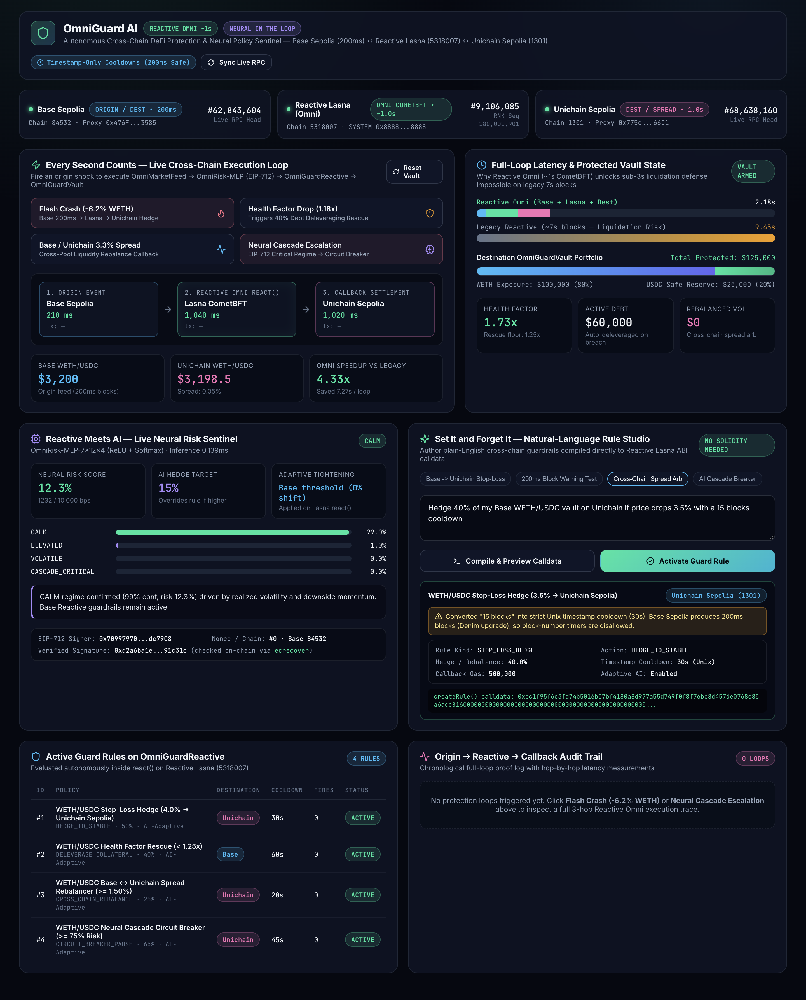
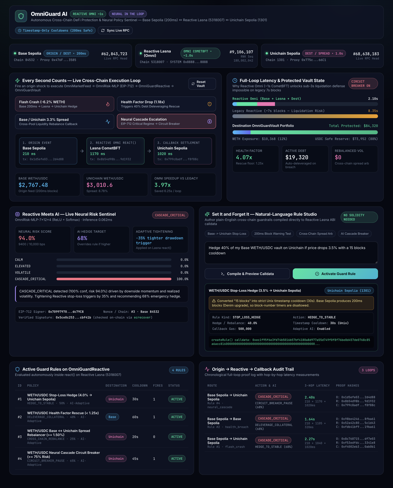
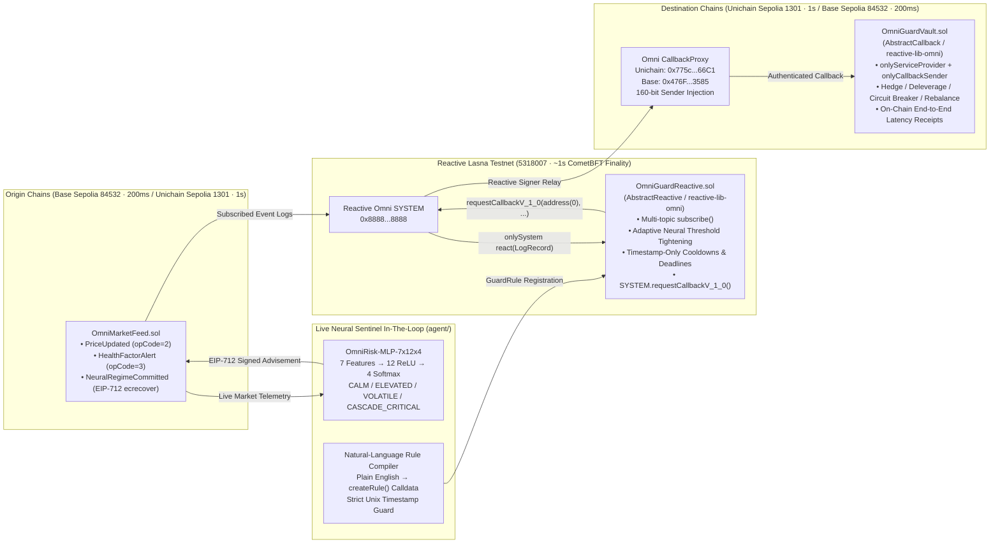

# OmniGuard AI

**Autonomous Cross-Chain DeFi Risk Sentinel & Neural Policy Co-Pilot powered by Reactive Omni (~1s CometBFT Finality)**

Built for the **DoraHacks Reactive Omni Buildathon** targeting:
- **Every Second Counts** — Sub-3-second cross-chain stop-loss hedging, liquidation rescue, and Base Sepolia (200ms) &harr; Unichain Sepolia (1s) liquidity rebalancing via Reactive Lasna (~1s CometBFT finality).
- **Set It and Forget It** — Natural-language rule authoring studio that compiles plain-English protection intents directly into `OmniGuardReactive.createRule()` ABI calldata with automatic Base Sepolia 200ms timestamp safety enforcement.
- **Reactive Meets AI** — A live 2-layer neural network (`OmniRisk-MLP-7x12x4`) running directly inside the execution loop, classifying market stress regimes (`CALM` / `ELEVATED` / `VOLATILE` / `CASCADE_CRITICAL`), signing EIP-712 advisements verified on-chain via `ecrecover`, and dynamically tightening Reactive drawdown thresholds and emergency hedge ratios.

---

## Live Dashboard Preview

| Command Console & Live 3-Chain RPC Telemetry | Post-Cascade Execution Proof & Neural Escalation |
|---|---|
|  |  |

---

## Architecture



---

## Why Reactive Omni Matters Here

On Base Sepolia's Denim upgrade (**200ms blocks**) and Unichain Sepolia (**1s blocks**), liquidation cascades unfold in seconds:

| Execution Layer | Origin Confirm | Reactive Finality | Callback Delivery | Total End-to-End | Outcome |
|---|---:|---:|---:|---:|---|
| **Legacy Reactive (~7s blocks)** | ~0.21s | ~7.35s | ~1.02s | **~8.58s – 9.50s** | Too slow — vault liquidated before callback lands |
| **Reactive Omni (CometBFT ~1s)** | ~0.21s | **~1.04s** | ~1.02s | **~2.27s (Base &rarr; Unichain)** / **~1.57s (Base &rarr; Base)** | **~4.2x faster** — hedge & deleveraging settle before cascade completes |

### Strict Base Sepolia 200ms Timestamp Discipline
Every cooldown, rule expiration (`expiresAt`), EIP-712 advisement deadline (`validUntil`), and latency receipt across `OmniMarketFeed`, `OmniGuardReactive`, and `OmniGuardVault` uses **Unix timestamps (`uint64` seconds via `block.timestamp`) — never `block.number` counts**.
- Verified by dedicated Foundry invariant test `test_TimestampCooldownInvariant_Under200msBaseBlocks()` (advances `+50` block numbers with only `+10s` wall time and proves premature execution is blocked until the full `30s` timestamp cooldown elapses).
- Enforced inside the Natural-Language Rule Compiler: if a user writes *"15 blocks cooldown"*, the compiler automatically converts it to Unix seconds and surfaces an explicit Base Sepolia 200ms safety advisory.

---

## Verified Reactive Omni Testnet Parameters

All addresses and fee parameters were verified live via JSON-RPC against `dev.reactive.network` and `Reactive-Network/reactive-lib-omni` (`3ade0dcf`):

| Network | Chain ID | RPC URL | Verified Omni System / Callback Proxy | Live Proxy Fee Params (`coeff / extraGas / maxChargeGas`) |
|---|---:|---|---|---|
| **Reactive Lasna** | `5318007` | `https://lasna-rpc.rnk.dev/` | `0x8888888888888888888888888888888888888888` | `1000` / `100,000` / `50,000` |
| **Base Sepolia** | `84532` | `https://sepolia.base.org` | `0x476F44b11F5C942c58f4c8E3d0300E5710743585` | `1100` / `80,000` / `50,000` |
| **Unichain Sepolia** | `1301` | `https://sepolia.unichain.org` | `0x775c9B990ADe401060B78D0e98684eEf8d2466C1` | `1100` / `80,000` / `50,000` |
| **Base Sepolia lREACT Faucet** | `84532` | `https://sepolia.base.org` | `0x2afaFD298b23b62760711756088F75B7409f5967` | `1 SepETH -> 100 lREACT` (max `5 ETH`) |

> **Callback Gas Sizing:** Because Base Sepolia and Unichain Sepolia Omni CallbackProxies reserve `80,000 (_extraGas) + 50,000 (_maxChargeGas) = 130,000` gas before forwarding to the recipient, `OmniGuardReactive` enforces `callbackGasLimit >= 250,000` (default `500,000`) to guarantee zero `InsufficientGas` failures.

---

## Repository Structure

```text
reactive-omni/
├── SPEC.md                              # Verified DoraHacks & Reactive Omni technical spec
├── contracts/                           # Foundry project (Solidity 0.8.29, reactive-lib-omni)
│   ├── src/
│   │   ├── interfaces/IOmniGuardTypes.sol   # Shared enums, GuardRule structs, canonical topic0 hashes
│   │   ├── origin/OmniMarketFeed.sol        # Base/Unichain price & HF feed + EIP-712 neural verifier
│   │   ├── reactive/OmniGuardReactive.sol   # Lasna AbstractReactive multi-rule + adaptive AI engine
│   │   └── destination/OmniGuardVault.sol   # Unichain/Base AbstractCallback protection & rebalance vault
│   ├── test/
│   │   ├── mocks/MockOmniSystem.sol         # Faithful Omni SYSTEM (0x8888...8888) test double
│   │   ├── mocks/MockOmniCallbackProxy.sol  # Faithful 160-bit sender-injecting CallbackProxy double
│   │   └── OmniGuardEndToEnd.t.sol          # 18 unit, security, timestamp-invariant, E2E & fuzz tests
│   └── lib/reactive-lib-omni/               # Official Reactive-Network/reactive-lib-omni
├── agent/                               # Live Neural Risk Sentinel & NL Rule Compiler backend
│   └── src/
│       ├── neuralModel.ts                   # OmniRisk-MLP-7x12x4 neural network (ReLU + Softmax)
│       ├── ruleCompiler.ts                  # Natural-language -> createRule() ABI calldata compiler
│       ├── eip712Signer.ts                  # EIP-712 NeuralAdvisement signer matching OmniMarketFeed
│       ├── server.ts                        # Live RPC telemetry + simulation + API server (:18788)
│       └── neuralModel.test.ts              # Automated neural, NLP compiler & EIP-712 unit tests
├── dashboard/                           # React 18 + Vite + TypeScript Mission-Control UI (:5178)
├── scripts/                             # One-command testnet deployment & full-loop proof scripts
│   ├── deploy-origin.ts                     # Step 1: Deploy Base & Unichain OmniMarketFeed (+ optional faucet)
│   ├── deploy-reactive.ts                   # Step 2: Deploy OmniGuardReactive on Lasna + verify rnk_getFilters
│   ├── deploy-destination.ts                # Step 3: Deploy Vaults, fund proxies, register GuardRules
│   └── trigger-demo.ts                      # Step 4: Fire full loop & capture DoraHacks proof tx hashes
└── docs/
    ├── DEMO_SCRIPT.md                       # Tight 2m30s DoraHacks demo video script
    └── screenshots/                         # Visually verified dashboard renders
```

---

## Quick Start (Local Build, Tests & Interactive Console)

### 1. Run Foundry Smart Contract Test Suite (18 Tests — 100% Pass)
```bash
cd contracts
forge test -vv --gas-report
```

Verified test coverage includes:
- Canonical `topic0` selector verification against Solidity event signatures
- Full cross-chain loops: Base Sepolia flash crash &rarr; Lasna `react()` &rarr; Unichain `OmniGuardVault` stop-loss hedge, health-factor debt deleveraging, cross-chain spread rebalancing, and EIP-712 neural cascade escalation
- **Adaptive AI Threshold Tightening:** proves a `-3.0%` drop is ignored in `CALM` regime (`4.0%` threshold), then immediately fires once the live Neural Sentinel commits `CASCADE_CRITICAL` (`4.0% -> 2.6%` tightened threshold + boosted `50%` hedge)
- **Base Sepolia 200ms Timestamp Cooldown Invariant:** proves `+50` block numbers with `+10s` elapsed stays locked under a `30s` cooldown and unlocks strictly at `+30s`
- Security & auth guards: `onlySystem`, dual `onlyServiceProvider` + `onlyCallbackSender`, EIP-712 signer/nonce/expiry verification, duplicate callback replay rejection, silent non-matching log fallthrough, CRON toggle, `AbstractPayer` debt settlement, and 256-run fuzz value conservation.

### 2. Run Live Neural Sentinel Backend & Tests
```bash
cd agent
npm install
npm test
npm run dev
```

### 3. Launch Interactive React Dashboard
```bash
cd dashboard
npm install
npm run dev
```
Open `http://127.0.0.1:5178` — the dashboard automatically connects to live Base Sepolia, Reactive Lasna (`rnk_getCommittedSequenceFrontier`), and Unichain Sepolia RPC heads while letting you trigger full cross-chain loops and compile plain-English guard rules.

---

## One-Command Testnet Deployment & Live Proof Generation

1. Copy `.env.example` to `.env` and populate `DEPLOYER_PRIVATE_KEY` (a funded testnet wallet holding Base Sepolia ETH, Unichain Sepolia ETH, and Lasna `lREACT` — or pass `--claim-faucet` in Step 1 to swap `0.05` Base Sepolia ETH for `5 lREACT` automatically):
   ```bash
   cp .env.example .env
   ```
2. Compile contracts so `contracts/out/` artifacts are fresh:
   ```bash
   cd contracts && forge build && cd ..
   ```
3. Install script dependencies and deploy the entire 3-chain topology in Reactive Omni's mandatory order (`Origin -> Reactive Lasna -> Destination Vaults & Rules`):
   ```bash
   cd scripts
   npm install
   npx tsx deploy-origin.ts --claim-faucet   # Step 1: Base & Unichain OmniMarketFeed
   npm run deploy:reactive                   # Step 2: Lasna OmniGuardReactive + rnk_getFilters check
   npm run deploy:destination                # Step 3: Base & Unichain OmniGuardVault + proxy depositTo() + rules
   ```
4. Execute a live full-loop proof run and print DoraHacks submission hashes + measured latency:
   ```bash
   npm run demo:trigger
   ```
   Output is persisted to `deployments/testnet.json` (all contract addresses) and `deployments/last-proof.json` (`originTxHash`, `neuralAdvisementTxHash`, `reactiveTxHash`, `callbackTxHash`, and measured `onChainEndToEndLatencySec` / `wallClockEndToEndMs`).

---

## Demo Video Script (2m 30s)

See [docs/DEMO_SCRIPT.md](docs/DEMO_SCRIPT.md) for the full timestamped 2-minute-30-second walkthrough script covering problem framing, live 3-chain telemetry, natural-language rule compilation, live neural adaptive tightening, and full-loop `Origin -> Reactive Lasna -> Unichain Callback` tx hash verification.

---

## License

MIT License — see [LICENSE](LICENSE). Vendored dependencies: `Reactive-Network/reactive-lib-omni` (`3ade0dcf`) and `foundry-rs/forge-std` (`15b2df92`).
